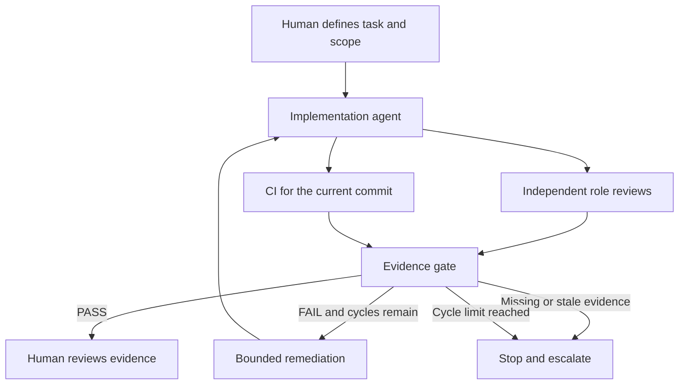

# Cursor Agentic Delivery Demo

A public reconstruction of a Cursor Cloud Agents delivery workflow I built and operationalised: bounded implementation, independent review, commit-specific CI evidence and a controlled remediation loop.

The repository includes reusable prompts, synthetic evidence and a runnable Python decision gate. **It does not contain employer code or production run records.** The public gate is a new educational implementation of the pattern, not the production orchestrator. It does not invoke Cursor, open pull requests or deploy software.

## Run the demo

Python 3.10 or newer; no third-party packages, accounts or credentials required.

```sh
python3 demo.py
python3 -m unittest discover -s tests -v
```

The default demonstration prints these decisions:

| Synthetic scenario | Verdict | Next action |
| --- | --- | --- |
| Independent reviews and CI match the current commit | PASS | Human review |
| A reviewer finds a regression | FAIL | Remediate within the cycle limit |
| CI evidence belongs to a previous commit | ESCALATE | Stop |
| Two remediation cycles end with unresolved findings | ESCALATE | Stop |

PASS means the evidence can be presented to a person. It does not authorise a merge, deployment or release.

To inspect one report:

```sh
python3 demo.py --evidence examples/evidence/stale-commit.json
```

Single-report exit codes are `0` for PASS, `1` for FAIL and `2` for ESCALATE or malformed input. The default multi-scenario demonstration exits `0` when every fixture produces its expected decision.

## Workflow



See the [case study](docs/case-study.md), [Cursor setup guide](docs/cursor-setup.md), [evidence contract](docs/evidence-contract.md), [implementation prompt](prompts/implementation.md), [independent-review prompt](prompts/independent-review.md) and [remediation prompt](prompts/remediation.md).

## What the gate checks

The example policy requires a human-approved, low-risk task; an implementation report; backend, frontend, PR-readiness and technical-QA reviews; and successful build, unit-test and lint records. Every report must identify the same 40-character commit SHA. Review agents must be distinct from the implementation agent and from one another. A negative finding produces a bounded remediation decision; missing evidence, inconsistent commits or policy breaches stop the run.

These exact fields and low-risk-only policy are choices made for this public demonstration. They are not an export of a private Cursor Automation configuration.

The gate validates supplied JSON snapshots. It does not authenticate reviewer identities, verify signatures, query a Git provider or prove that recorded commands ran. A production system must collect trusted evidence and enforce its own permissions before relying on this decision. Prompt instructions alone do not enforce access controls.

## Why I built the original workflow

AI-generated changes needed an independent check and a reliable way to connect reviews to the code being considered. I organised reusable rules and skills, controlled context and separate implementation/review roles around that problem. In an audited operational run, reviewers found regressions, remediation corrected them, and the workflow stopped before opening a PR when the final evidence did not match the required commit.

That observed stop is useful evidence of a boundary working. It is not a claim of a measured productivity or accuracy improvement. The wider AI delivery programme is progressing from accelerated work toward orchestrated delivery; this repository makes no claim of full autonomous release.

## Reuse

Use the prompts with a repository you are authorised to access, adapt the policy and evidence requirements, and keep final release authority with the accountable person. [Cursor's automation documentation](https://cursor.com/docs/cloud-agent/automations) explains how to configure triggers, tools and repository access. This repository provides prompts and a local demonstration, not an account-specific Terraform export.

Created by [Luis Ángel Parada Rodríguez](https://luisangelparada.com/). Code and documentation are available under the [MIT licence](LICENSE).
